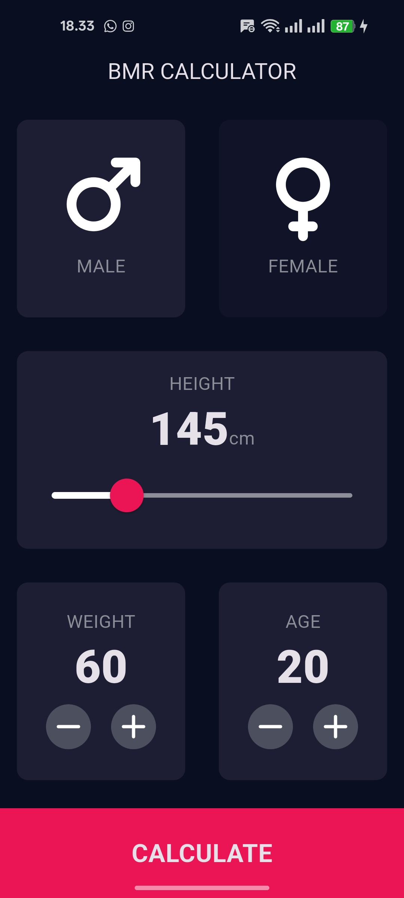
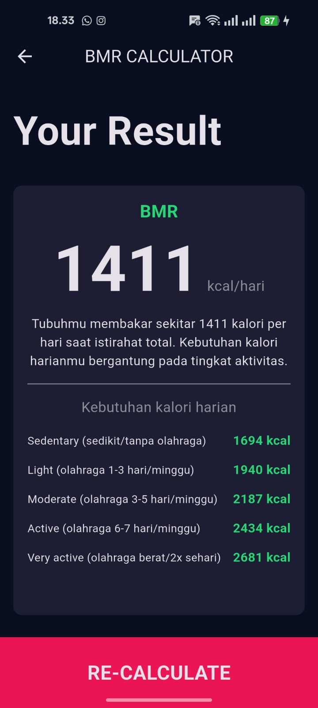

# BMR Calculator

## Anggota Kelompok
1  | Merallda Prisca Daniza | K3524014 |
2  | Winda Luthfi Itsnaini| K3524016 |
3  | Aliswandani Nashifa S. P. | K3524022 |

## Deskripsi
BMR Calculator adalah aplikasi mobile yang dibuat dengan Flutter (Dart)
untuk menghitung Basal Metabolic Rate, yaitu jumlah kalori yang dibutuhkan
tubuh untuk menjalankan fungsi dasar saat istirahat total.

Aplikasi ini dikembangkan dari kalkulator BMI dengan perubahan:
- Menambahkan input **umur**
- Menampilkan estimasi **kebutuhan kalori harian** berdasarkan tingkat aktivitas

### Fitur
- Pilih jenis kelamin (Male / Female)
- Atur tinggi badan dengan slider
- Atur berat badan dan umur dengan tombol + dan -
- Hasil BMR dalam kcal/hari
- Kebutuhan kalori harian untuk 5 tingkat aktivitas

## Screenshot
| Halaman Input | Halaman Hasil |
|---------------|---------------|
|  |  |

## Referensi
https://www.calculator.net/bmr-calculator.html